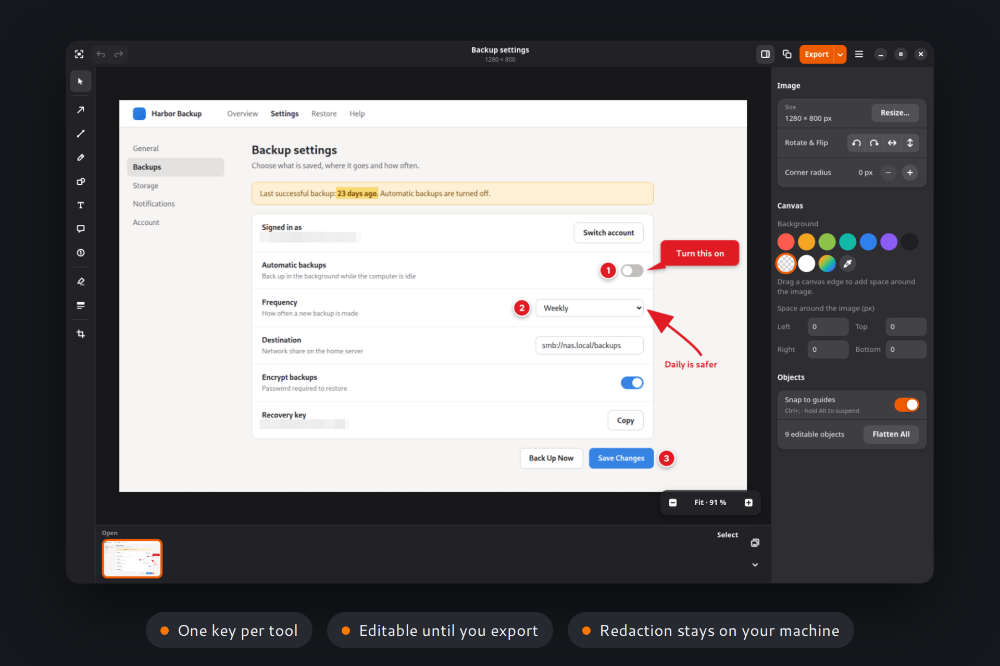
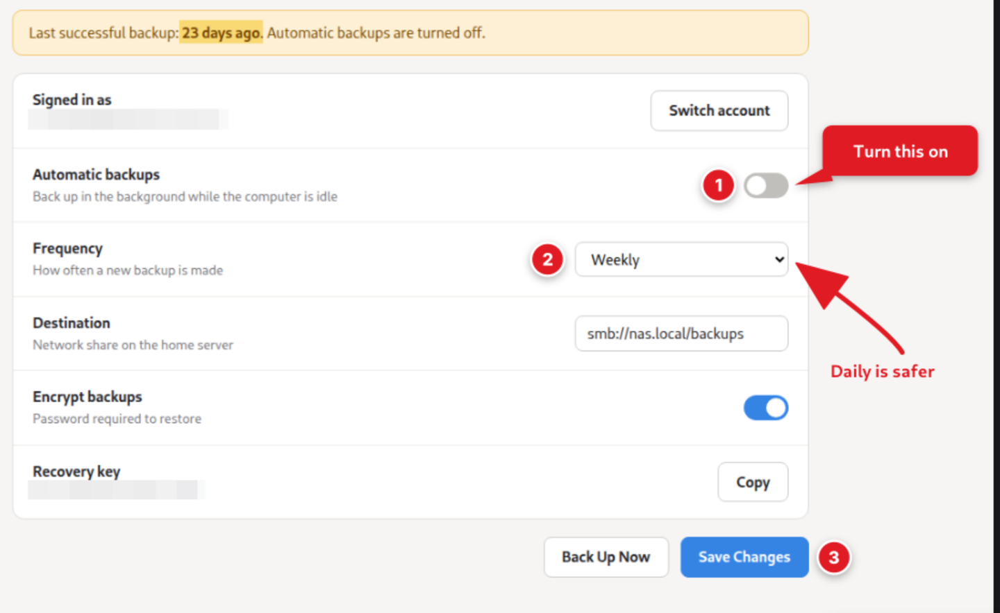
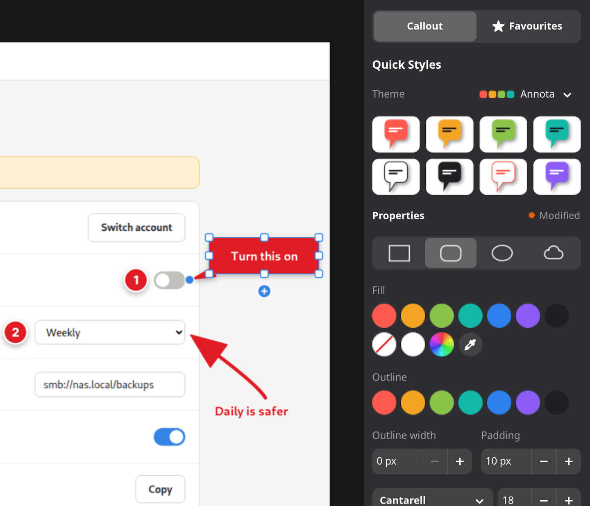
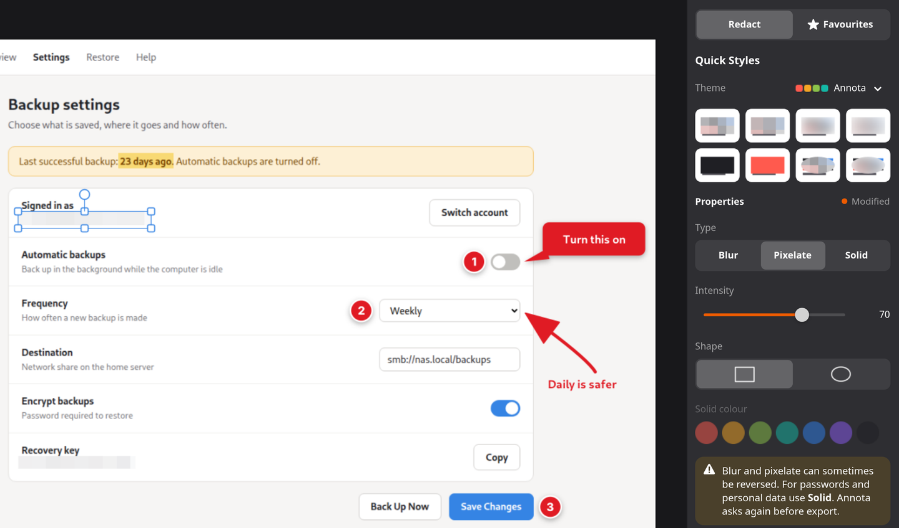
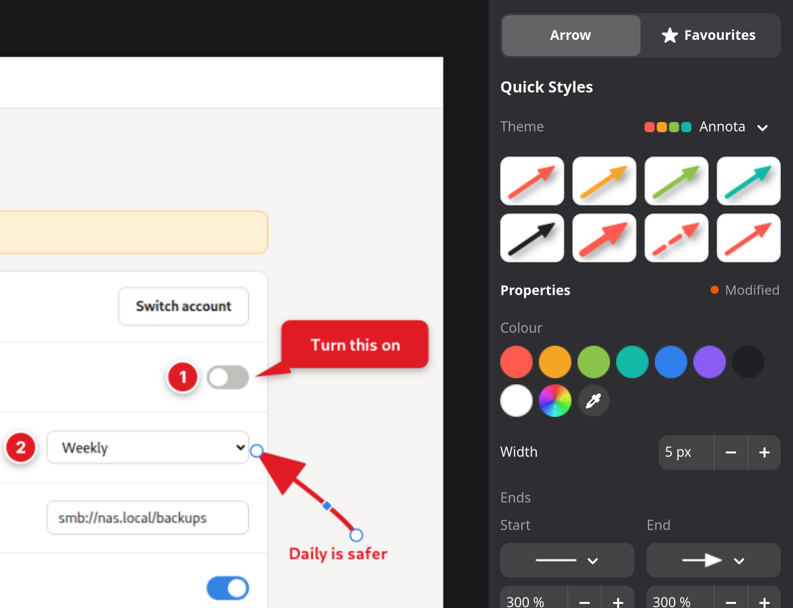
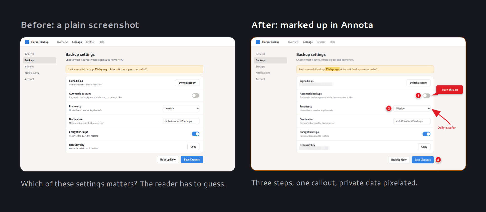

<div align="center">


# Annota

**Capture it. Mark it up. Make it obvious.**

Annotated screenshots for GNOME – editable until you export.



</div>

You explain software with screenshots – in a support ticket, a how-to, a bug report or a handout.
A plain screenshot makes the reader guess where to look. Annota lets you point at exactly what
matters, hide what is private, and change your mind until the moment you share it.
It is a native GNOME app for Ubuntu and Debian, and it never sends anything anywhere.

> **Status: pre-alpha.** Capture, the editor, the annotation tools, styles and export work today.
> Version 0.1.0 is out – [install it from the APT repository](#get-started). The capture
> library, screen recording and text recognition are [planned](#roadmap).

## Why Annota

### Point at exactly what matters

Arrows, callouts, numbered steps, shapes, text and a highlighter – each one key away.



### Change your mind later

Every annotation stays an object: move it, restyle it or delete it at any time. Save as `.annota`
and keep editing tomorrow.



### Share without oversharing

Blur, pixelate or black out names, e-mail addresses and keys before you share. Annota warns you
when blur or pixelate is not enough – and it never opens a network connection.



### Look consistent in one click

Quick styles and themes give every arrow, callout and step the same colours and fonts.



## Before and after



## Get started

Install Annota from its signed APT repository. On Ubuntu 24.04 or newer, or Debian 13:

```bash
curl -fsSL https://trosinde.github.io/Annota/annota-archive-keyring.asc \
  | sudo tee /usr/share/keyrings/annota-archive-keyring.asc
echo "deb [signed-by=/usr/share/keyrings/annota-archive-keyring.asc] \
  https://trosinde.github.io/Annota/apt noble main" \
  | sudo tee /etc/apt/sources.list.d/annota.list
sudo apt update && sudo apt install annota
```

`apt` checks every download against Annota's release key, and `sudo apt upgrade` brings you
new releases.

Prefer not to add a repository? Download the `.deb` from the
[latest release](https://github.com/trosinde/Annota/releases/latest) and install it with
`sudo apt install ./annota_*_amd64.deb`. You then install updates by hand. To build from
source instead, see [Install Annota](docs/how-to/install.md#build-from-source).

Annota opens with three buttons: **Region**, **Window** and **Screen**. Pick one, and the capture
opens in the editor. Next: [your first annotated screenshot](docs/tutorials/first-steps.md).

## Learn more

- **Tutorial** – [Your first annotated screenshot](docs/tutorials/first-steps.md)
- **How-to guides** – [Install Annota](docs/how-to/install.md) · [Build the Debian package](docs/development/building.md)
- **Reference** – [Keyboard shortcuts](docs/reference/keyboard-shortcuts.md) · [Feature catalogue](docs/feature-catalog.md)
- **Explanation** – [Architecture](docs/explanation/architecture.md) · [Decision records](docs/adr/)
- **All documentation** – [docs/](docs/README.md)

## Roadmap

- **MVP 0.1:** app shell and packaging · screen capture · editor and `.annota` format · core tools · quick styles and themes · export and share · capture library
- **Phase 2:** advanced tools · effects · capture presets · text recognition · smart redaction · library search, tags and collections · templates · screen recording
- **Phase 3:** scrolling capture · step capture · smart move and simplify

Every change is specified in [`openspec/changes/`](openspec/changes) before it is built –
see [how Annota is built](docs/development/workflow.md).

## Project

[Contributing and workflow](docs/development/workflow.md) · Privacy: no accounts, no cloud, no
telemetry · License: MIT for code, CC-BY-SA-4.0 for artwork and docs.

Annota is an independent project and is not affiliated with any commercial screenshot tool.
