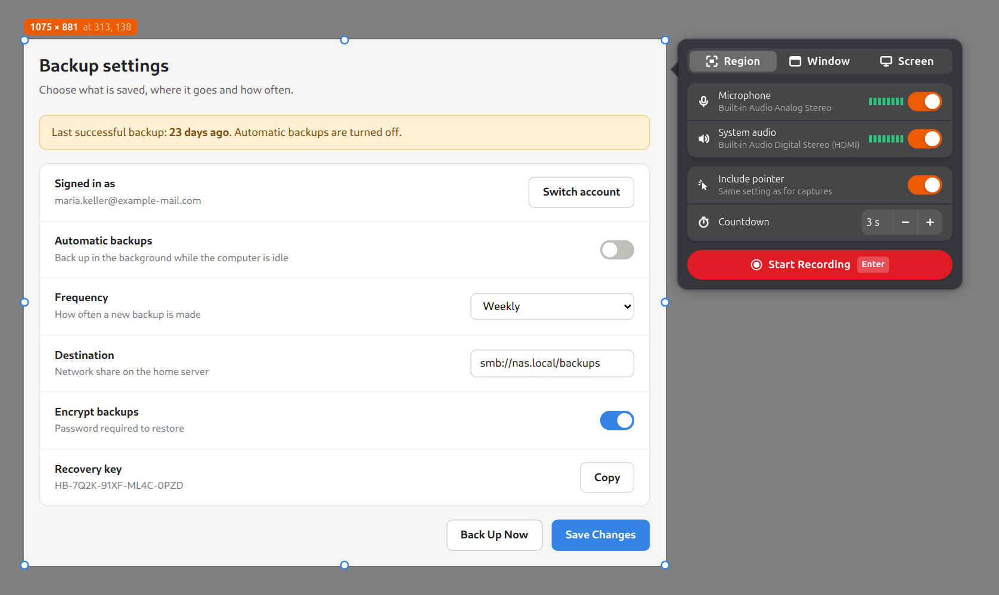
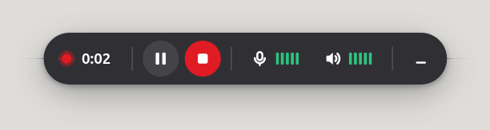
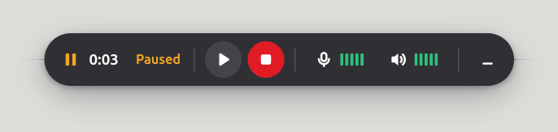
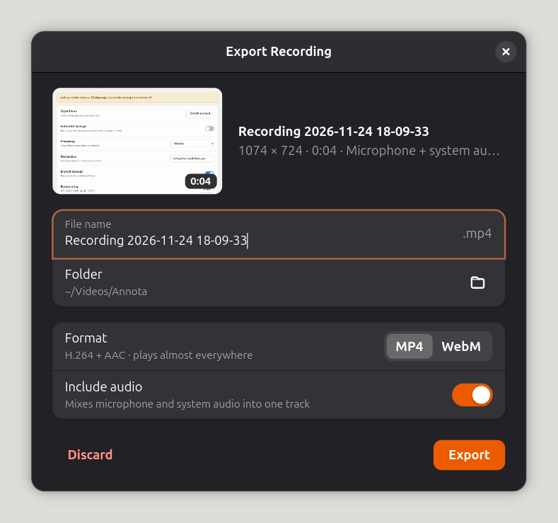
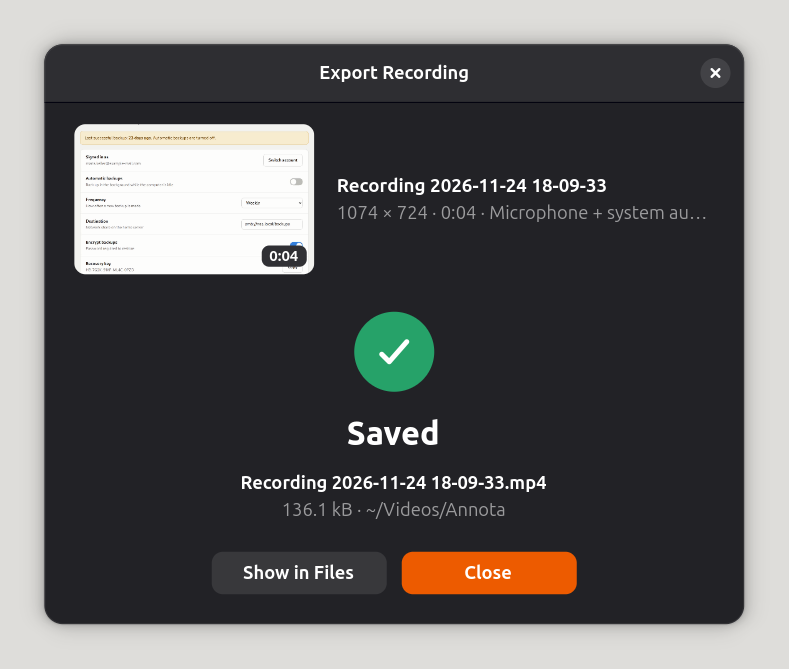

# How to record the screen

Annota 0.2.0 records a region, a window or a whole screen as a video, with your microphone and
the system audio if you want them, and saves it as MP4 or WebM. Like every capture, recording
goes through the desktop's screen-sharing portal: GNOME asks you which screen or window to
share, and nothing leaves your machine.

## Start a recording

Pick any of these:

- Press the **Record video** shortcut. Annota asks GNOME for `Super+Alt+R`; GNOME may assign
  a different key or ask you to confirm it. The trigger GNOME actually uses is shown in
  **Preferences › Capture › Record video** and on the Record card. To change it, use GNOME
  Settings › Apps › Annota › Global Shortcuts.
- Click the **Record** card in Annota's start window, next to Region, Window and Screen.
- Run `annota --record region`, `annota --record window` or `annota --record screen` from a
  terminal. `annota --record toggle` does the same as the Record shortcut.

The shortcut, the Record card and `annota --record region` open the region overlay in
**Video** mode. You can also switch an open overlay to Video with its mode pill.

## Set up the recording

Next to the selection, the recording setup offers:



| Setting | What it does |
|---|---|
| Source | **Region** (the area you select), **Window** or **Screen** |
| Microphone | records your default microphone, with a level meter |
| System audio | records what your default audio output plays |
| Include pointer | shows the mouse pointer in the video (the same setting as for screenshots) |
| Countdown | 0 to 10 seconds before the recording starts, 3 by default |

Press **Enter** or click **Start Recording**. **Esc** cancels without recording anything.
Annota remembers your choices for the next recording.

If a row is greyed out, Annota could not find the device ("No microphone found", "No audio
output found"), or the desktop does not offer screen sharing for that source.

## Choose what to share

GNOME now shows its screen-sharing dialog. Annota shows "Waiting for a screen…" or "Waiting for
a window…" until you choose; press **Esc** to give up. For a region, choose the screen that
contains your selection. If the selection is not on the chosen screen, Annota says so and
records nothing.

After you share, the countdown "Recording starts in N s" runs. **Enter** starts at once,
**Esc** cancels. Neither the waiting indicator nor the countdown ends up in the video.

## While recording

A small **Recording** window shows the elapsed time and the controls. While it has the focus:



| Key | Action |
|---|---|
| Space | Pause or resume |
| M | Mute or unmute the microphone |
| S | Mute or unmute system audio |

- **Pause** leaves the paused time out of the video; it continues seamlessly after Resume.
  While paused, the control reads **Paused** and Pause turns into Resume:

  
- **Mute** records silence for that source, so the video keeps its length.
- **Minimize** hides the control; the recording goes on. Pressing the Record shortcut or
  clicking the Record card again brings the control back and does not start a second recording.

GNOME places the control window like any other window. It is not kept out of the recorded area,
so move it aside or minimise it if it should not appear in the video.

## Stop the recording

Any of these stops it:

- **Stop** in the Recording window
- the Record shortcut, also while paused
- GNOME's stop button for screen sharing in the top bar
- closing the window you are recording

## Export the video

The **Export Recording** window opens with a preview frame, the duration and these choices:

- **File name** – by default `Recording YYYY-MM-DD HH-MM-SS`
- **Folder** – the folder you used last time
- **Format** – **MP4** (H.264 video, AAC audio) or **WebM** (VP9 video, Opus audio)
- **Include audio** – microphone and system audio are mixed into one track; turn it off for a
  silent video



Press **Enter** or click **Export**. A progress bar shows the export, and **Cancel** stops it.
When it reads **Saved**, **Show in Files** opens the folder with the video selected. An existing
file is never overwritten: Annota adds ` (2)` to the name instead.



**Discard** throws the recording away after asking "Discard Recording?". Closing the window
before exporting asks the same question.

## Where the files go

While you record, Annota writes a working file
`Recording YYYY-MM-DD HH-MM-SS.mkv` into `~/Videos/Annota` (inside your Videos folder; created
if missing). If Annota crashes, that file is still there and plays up to the last second
written – open it with any video player. After a successful export the working file is
removed. To record into another folder:

```bash
gsettings set io.github.trosinde.Annota record-folder '/path/to/folder'
```

If writing fails during a recording, Annota stops, keeps what was recorded and opens the Export
Recording window with a message.

## Known limits in 0.2.0

- Microphone and system audio always use the desktop's default devices; there is no device
  picker. Change the defaults in GNOME Settings › Sound.
- One screen per recording; several monitors at once cannot be recorded.
- A window that gets bigger while you record it is scaled down to fit the video's size, with
  borders, never stretched.
- If a recording cannot start after **Start Recording** (for example, the recordings folder is
  not writable), Annota does not show a message yet. Nothing is recorded.
- Recordings do not appear in a capture library, and a screenshot cannot be taken while a
  recording runs.
- Recording has been tested on GNOME 50 (Ubuntu 26.04, Wayland). Ubuntu 24.04 (GNOME 46) and
  X11 sessions are not yet measured.
- Webcam overlay, cursor highlights, drawing on screen, trimming and GIF export are planned for
  a later release.

Something not working? See [Troubleshooting](troubleshooting.md).
