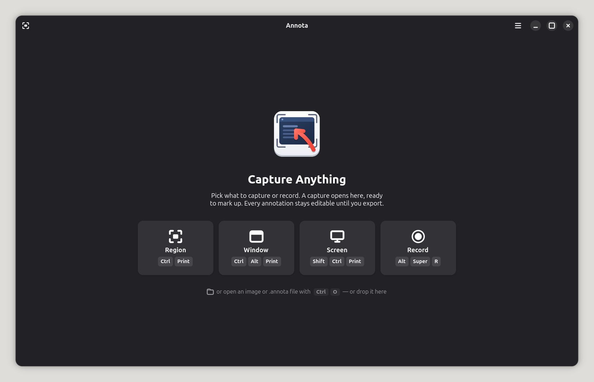

# Your first annotated screenshot

This tutorial takes you from a plain screenshot to an annotated image you can share, in about
five minutes. You need Annota running – see [Install Annota](../how-to/install.md).

## 1. Capture something

Click **Region** in Annota's start window, or press the shortcut shown on that card. Drag a
rectangle over the part of the screen you want and confirm. The capture opens in the editor.

The **Window** and **Screen** cards work the same way. Each card shows the key GNOME has really
assigned to it. On GNOME 48 and later, GNOME decides the keys (change them in Settings › Apps ›
Annota › Global Shortcuts), so they can differ from Annota's defaults **Print**, **Alt+Print** and
**Shift+Print**.

## 2. Point at what matters

- Press **S** for the step tool and click the first thing the reader should do. Click again for
  step 2 and 3 – the numbers count up by themselves.
- Press **K** for a callout, place it, and type a short instruction such as "Turn this on".
- Press **A** for an arrow and drag from the empty space to the target.

Every tool has one key; the toolbar on the left shows them in its tooltips.

## 3. Hide what is private

Press **B** for redaction and drag over an e-mail address or a name. In the sidebar choose
**Blur**, **Pixelate** or **Solid**. For passwords and personal data use **Solid** – blur and
pixelate can sometimes be reversed.

## 4. Change your mind

Press **V** to select. Click any annotation to move it, resize it or change its colour in the
sidebar. Nothing is baked into the image yet.

## 5. Save and share

- **Ctrl+S** saves an `.annota` file you can keep editing later.
- **Ctrl+E** exports PNG, JPG, WebP or PDF.
- **Ctrl+C** copies the finished image, ready to paste into a chat or ticket.

Some things are easier to show than to annotate: **Super+Alt+R** or the **Record** card
records a video instead – see [How to record the screen](../how-to/record-the-screen.md).

Next: the full list of [keyboard shortcuts](../reference/keyboard-shortcuts.md).
